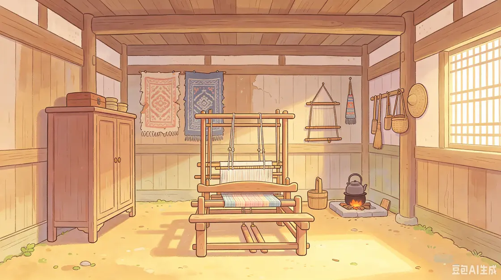

# 锦纹寻踪

《锦纹寻踪》是《侗锦织梦》项目的 Windows 课程 Demo。玩家跟随阿朵，在老宅、小院和鼓楼寻找散落的纹样并修复古锦。

[查看案例与设计展板](https://zephyraaaaa.github.io/portfolio/%E4%BA%A4%E4%BA%92%E4%B8%8E%203D/jinwen-xunzong/) · [GitHub Release](https://github.com/Zephyraaaaa/portfolio/releases/tag/jinwen-xunzong-demo)

- [原版 Windows 试玩包](https://github.com/Zephyraaaaa/portfolio/releases/download/jinwen-xunzong-demo/jinwen-xunzong-windows-demo.zip)
- [美术素材](https://github.com/Zephyraaaaa/portfolio/releases/download/jinwen-xunzong-demo/jinwen-xunzong-art-assets.zip)，含场景、角色、道具、UI 与分镜
- [项目视频素材](https://github.com/Zephyraaaaa/portfolio/releases/download/jinwen-xunzong-demo/jinwen-xunzong-video-assets.zip)，共 6 段
- [SHA-256 校验](https://github.com/Zephyraaaaa/portfolio/releases/download/jinwen-xunzong-demo/SHA256SUMS.txt)

在 Windows 上完整解压试玩 ZIP，再运行 `锦纹寻踪.exe`。请保留同目录的游戏数据和运行库。Windows 11 测试中可进入游戏场景，曾在加载后续场景后遇到 Unity 崩溃。
