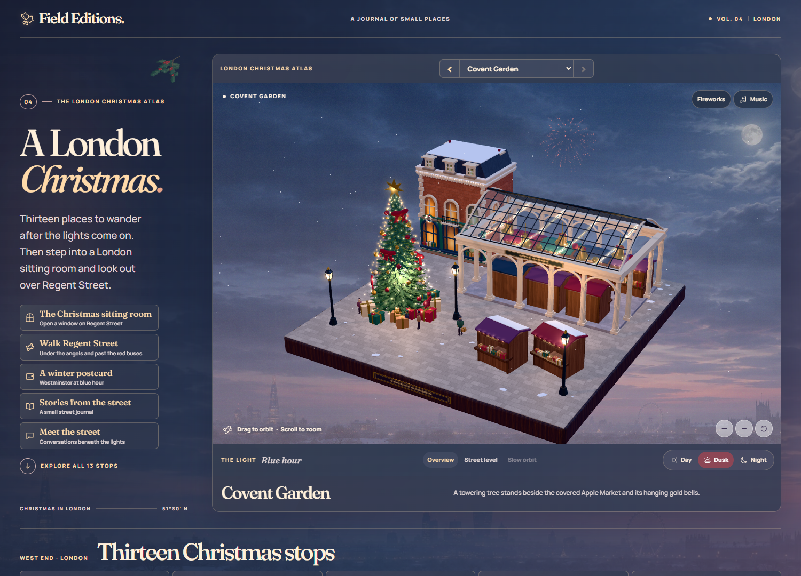
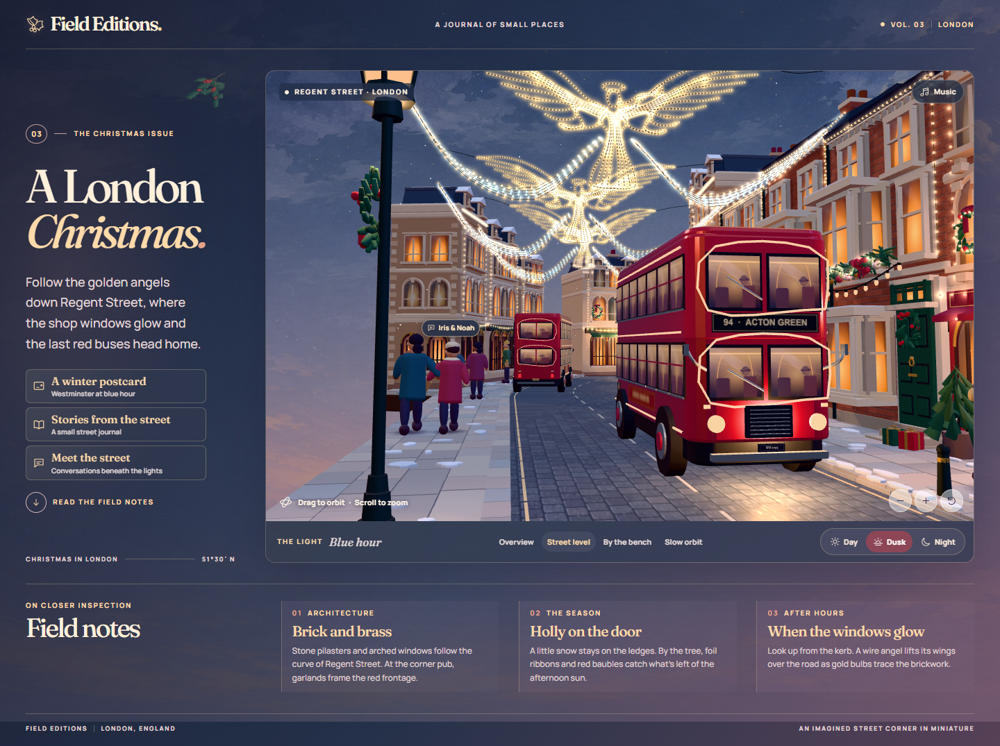
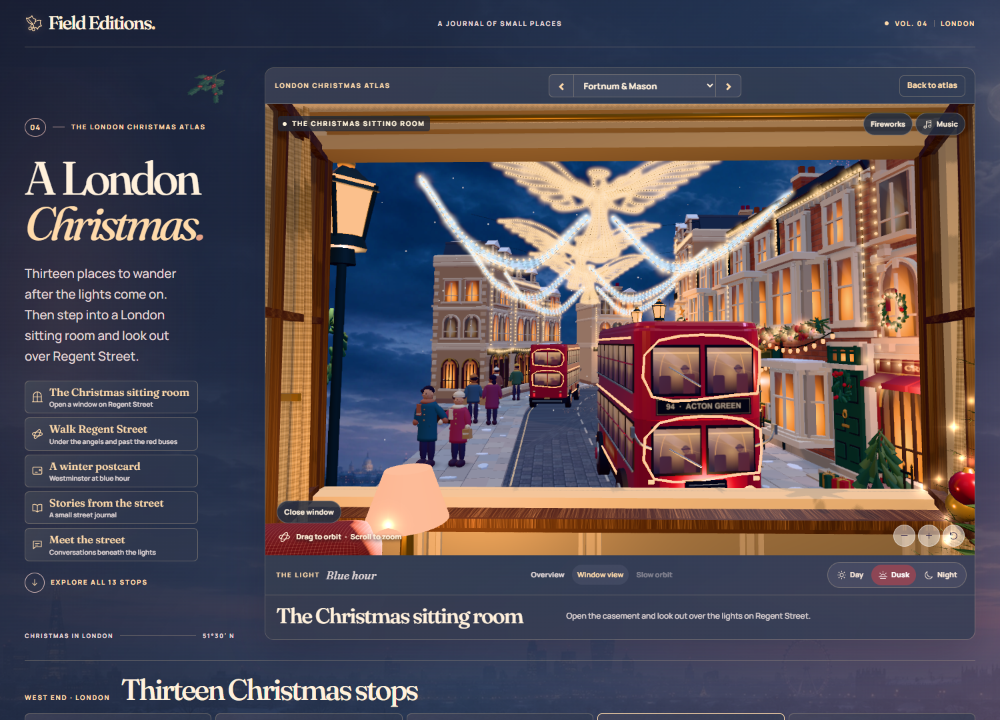
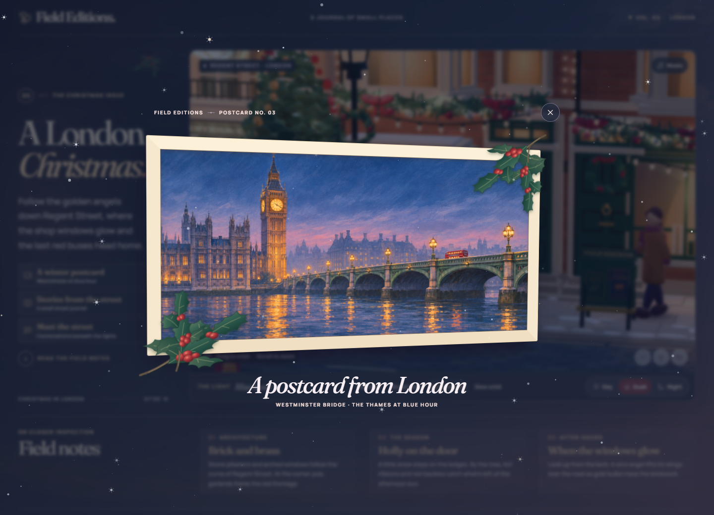

# 伦敦圣诞 · A London Christmas Atlas

《Field Editions》交互杂志的伦敦特辑。以 13 座 3D 微缩街景串起伦敦西区的圣诞灯饰、橱窗和市集，从考文特花园出发，也能走进一间正对摄政街的客厅。

[在线体验](https://a-london-christmas-atlas.chirpycrane64.chatgpt.site/) · [离线版 ZIP](a-london-christmas-v4-offline.zip) · [源码 ZIP](a-london-christmas-v4-source.zip)

## 设计理念

把伦敦圣诞做成一本可以走进去的生活方式杂志。每处地标用一块方形台座取景，保留建筑轮廓和节庆陈设。俯瞰时可以逐站浏览，降低镜头就能从巴士旁仰看天使灯。三档光线让同一组建筑从冬日斜阳过渡到夜间暖灯，窗扇与长椅提供两个可以停下来的视角。

## 项目工作

- 体验策划与美术指导涵盖 13 处地标、场景陈设、昼夜光影和镜头动线。
- 用 Codex 辅助实现 WebGL 交互原型，部分场景纹理和明信片插画用 ImageGen 生成。
- 交付在线体验、可离线打开的单文件 HTML，以及包含构建脚本的源码。

## 交互画面

切换到街道视角，从红色双层巴士旁仰看摄政街的天使灯。

打开客厅的木窗，移到窗前看正在下雪的街道。

点击长椅展开带透视摆动的明信片，画面里是蓝调时刻的威斯敏斯特桥与泰晤士河。

