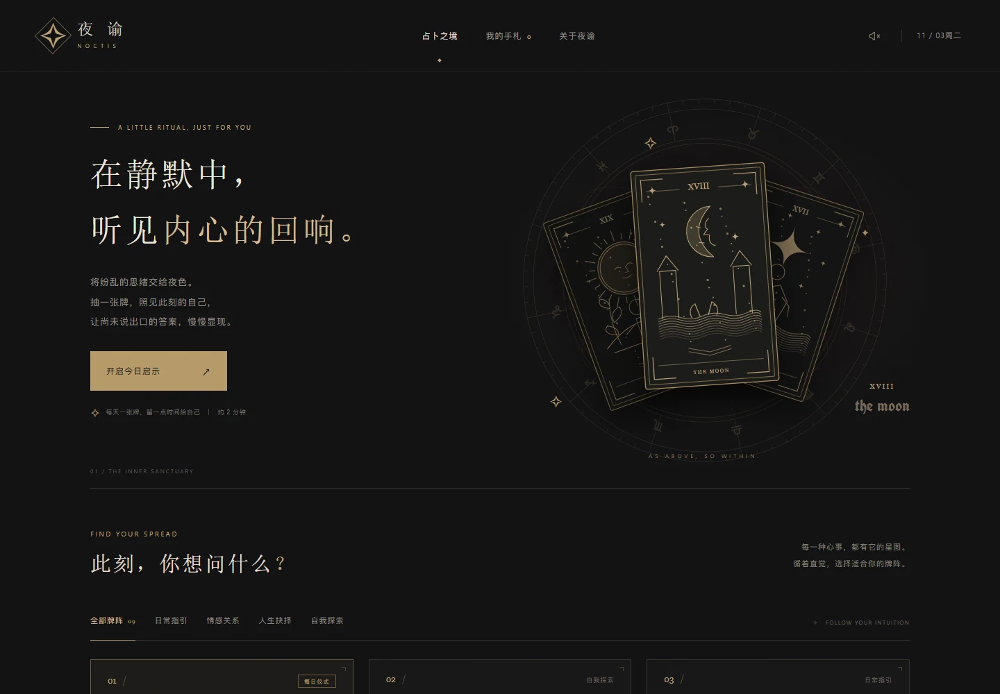

# 夜谕 · NOCTIS

一个黑金色调的互动塔罗网页。访客可以选择牌阵、抽牌、翻阅解读，并将感受写进浏览器手札。

[打开公开体验](https://noctis-tarot.chirpycrane64.chatgpt.site)

## 设计理念

把抽牌拆成选牌阵、聚焦问题、选牌和逐段显现四步。细线牌面、暗场和缓慢翻牌留出阅读停顿，桌面与手机都可用鼠标或触屏完成体验。

## 项目工作

- **体验策划** · 设计九种牌阵、抽牌流程和手札回看。
- **美术指导** · 统一黑金色调、线刻牌面与占星盘的视觉语言。
- **镜头与动效** · 从首页的牌面构图进入扇形牌堆，再用翻牌与文字显现引导阅读。
- **工具** · 牌面由项目内的 SVG 绘图代码绘制，手势识别使用 MediaPipe。Codex 用于本次上线整理、交互测试和作品集接入。

## 成果展示

公开网页包含 22 张大阿尔卡那牌面、九种牌阵、可选摄像头手势、浏览器本地手札和 Markdown 导出。手札保存在各访客的浏览器内，公开体验入口为首页。
