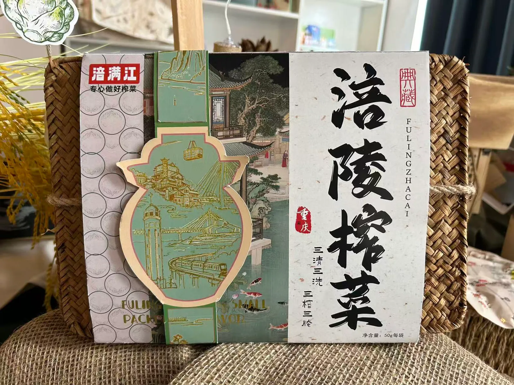

# 涪满江榨菜系列包装设计

受重庆涪满江生态农业科技有限公司委托，在产教融合项目中完成袋装、罐装与礼盒的系列包装设计和实物展示。

[打开公开案例页](https://zephyraaaaa.github.io/portfolio/%E5%93%81%E7%89%8C%E4%B8%8E%E5%8C%85%E8%A3%85/fulmanjiang/)

企业委托围绕 70 g 销售包装、600–800 g 礼盒和包装容器展开。项目交付包含 50 g 与 70 g 小袋、瓶贴、中包装和礼盒等设计文件，并制作了包装样品。礼盒的编织外盒与青绿腰封搭配，纸套上写有「三榨三腌」工艺说明。

- [礼盒工艺说明实拍](images/process.webp)
- [袋装样品](images/pouches.webp)
- [罐装样品](images/jar.webp)
- [系列包装与周边展陈](images/display.webp)
