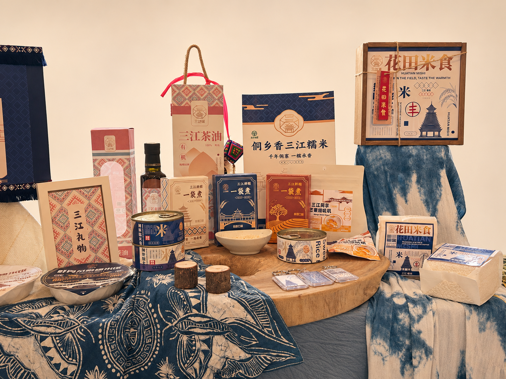

# 侗乡香——三江糯米产品包装系列

米兰设计周获奖作品。将风雨桥、鼓楼与侗族几何纹样转译为糯米米袋、罐装、碗装及礼盒的系列包装。

[打开公开案例页](https://zephyraaaaa.github.io/portfolio/%E5%93%81%E7%89%8C%E4%B8%8E%E5%8C%85%E8%A3%85/sanjiang-rice/)

- [原始展陈实拍](images/display-main.webp)
- [礼袋、罐装与碗装](images/display-bag.webp)
- [花田米食包装细节](images/display-detail.webp)
- [展陈全景](images/display-overview.webp)
- [品牌溯源与设计理念](images/board-origin.webp)
- [视觉识别与包装方案](images/board-system.webp)
- [包装效果图与周边](images/board-mockups.webp)

## 电商首图

ImageGen 以现场实拍为底图，将窗户、窗帘和柜架改成暖白棚拍背景，保留深蓝纹样桌布和右侧蓝染布。生成图局部包装小字有变化，核对文字和图形时可打开原实拍和原设计展板。

ImageGen 提示词

Use case: precise-object-edit. Input image 1 is the only edit target, the user's original 4:3 photo of the Dongxiangxiang Sanjiang glutinous rice packaging exhibit. Change ONLY the rear room backdrop: the bright windows and window views, the upper blue WINDOW curtain, the room wall and the upper shelving with bottles behind the display. Replace those background surfaces with a clean seamless warm ivory studio wall under soft diffuse e-commerce product lighting. IMPORTANT: Preserve all the original indigo and ivory ethnic-pattern textiles on and in front of the exhibit table. Keep the large dark indigo-and-cream batik cloth with its motifs and folds across the lower-left foreground, the blue-and-cream resist-dyed cloth draped beneath the wooden 花田米食 box on the right, and the other visible display cloth in the lower half. These Dong-culture textiles are important evidence and are NOT background to erase. Do not replace the table or foreground with a bare studio floor, and do not cover, recolor, straighten or simplify any visible cloth pattern. Keep the original wooden riser, tabletop objects, product arrangement, camera perspective and full framing. Protect the real photographed packages, their contours and material and all printed lettering and artwork, including 侗乡香三江糯米, 花田米食, 一袋煮, and 三江礼物. Keep the far left bag fragment and all other physical objects as in the photo. No new props, no label regeneration, no text overlays, no re-staging, no change in composition. The intended result is the same actual tabletop exhibit and original Dong textiles, with a warm-white e-commerce studio background only behind it. Return one edited 4:3 photo.

