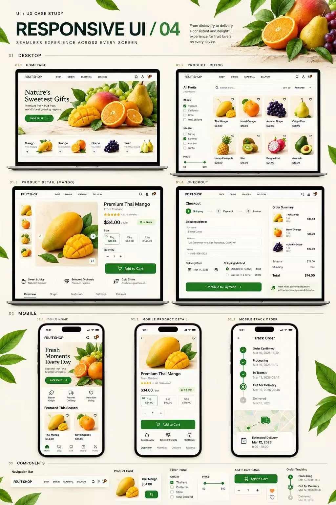
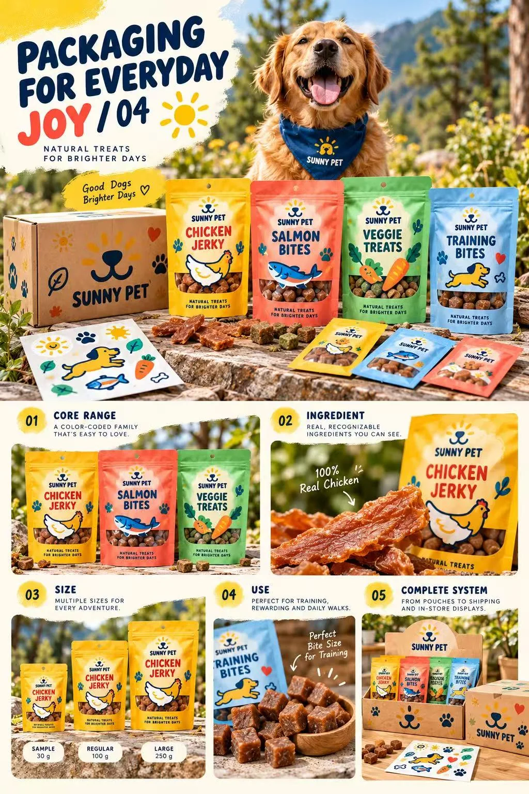
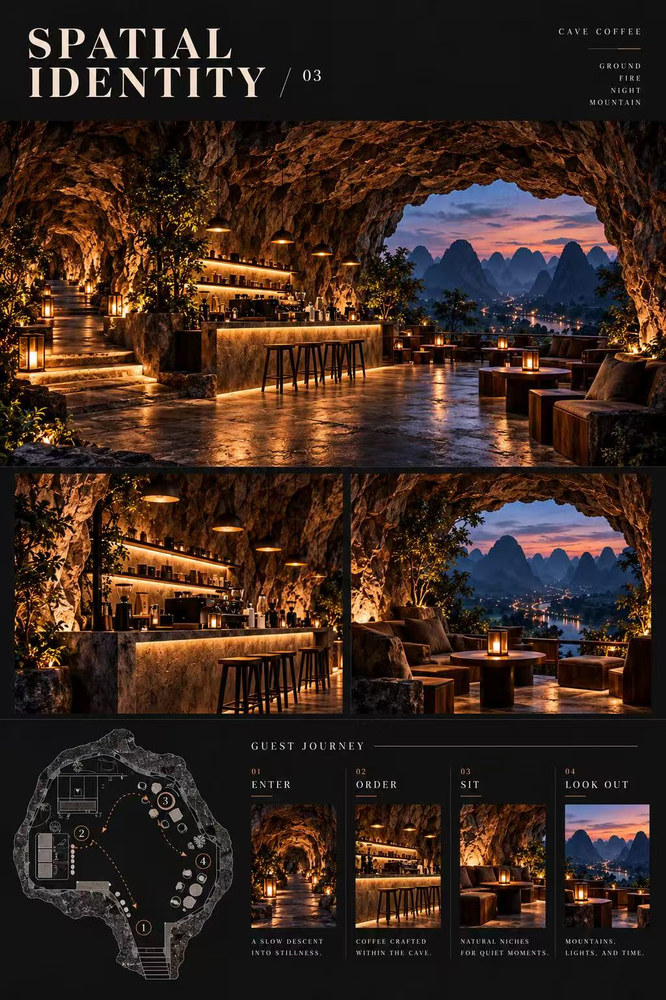
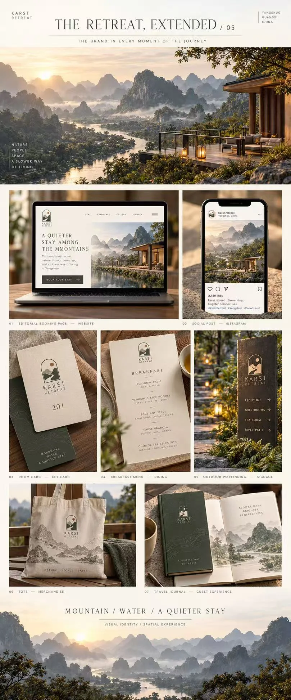
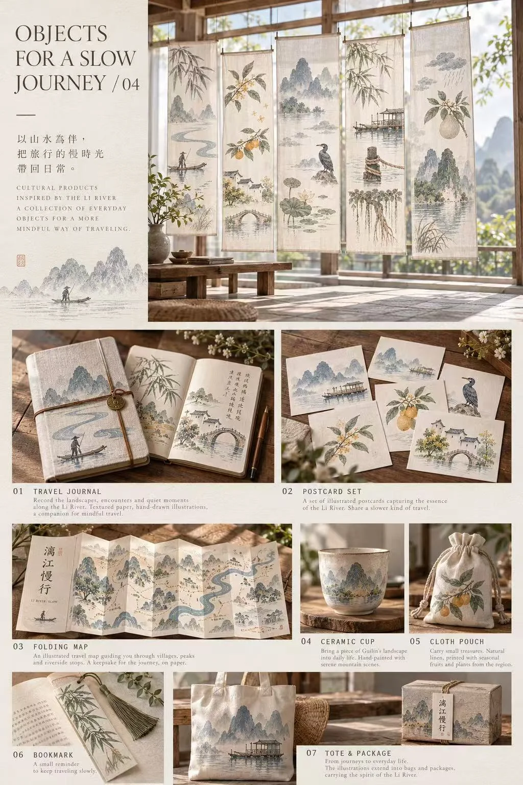

# Upwork 五个案例 · Form & Grove

五个独立设计概念，涵盖电商界面、品牌与包装、空间体验及旅行文创。

[Fruit Shop](#fruit-shop) · [Sunny Pet](#sunny-pet) · [Cave Coffee](#cave-coffee) · [Karst Retreat](#karst-retreat) · [Li River Slow](#li-river-slow)

## 工具与分工

- **个人工作** · 体验策划、美术指导和静态展示的镜头设计，具体做法见各案例。
- **Codex** · 用于本次梳理案例、编排图版、整理网页入口和发布。
- **图像生成** · 原项目将概念图、样机与空间氛围图标为 ChatGPT 辅助。ImageGen 的具体调用和图版对应关系待核。

以下成果为概念图版和样机。界面数据、包装说明及空间效果均为方案示意。

## Fruit Shop

### 项目简介

一套跨桌面与手机的精品水果电商界面概念，覆盖选购到配送追踪。

### 设计理念

用果实大图引导选购，在筛选、详情和结算页逐步呈现产地、规格与配送信息。

### 我的工作

- **体验策划** · 把商品发现、筛选、详情、购物车、结算和配送追踪串成购买流程，安排桌面与手机各自的展示重点。
- **美术指导** · 用果实近景、浅底和绿色操作按钮建立识别，统一商品卡、筛选栏与订单状态。
- **镜头设计（静态）** · 先展示桌面购物场景，再并排呈现桌面与手机界面，最后放大组件细节。

### 成果展示

5 张图版，包含购买路径、响应式界面概念和视觉组件。

[项目总览](images/fruit-shop-01-1024.webp) · [产地与服务](images/fruit-shop-02-1024.webp) · [购买路径](images/fruit-shop-03-1024.webp) · [响应式界面](images/fruit-shop-04-1024.webp) · [视觉设计系统](images/fruit-shop-05-1024.webp)

[查看英文案例](https://formandgrove.netlify.app/works/fruit-shop.html)

## Sunny Pet

### 项目简介

一套宠物零食品牌概念，用插画和颜色区分口味与用途，并延展到零售陈列。

### 设计理念

用太阳和宠物组成的标志保持亲和力，让插画与色彩承担货架上的快速识别。

### 我的工作

- **体验策划** · 以辨识口味、选择规格、购买和日常喂食为线索，安排包装正面信息与零售展示。
- **美术指导** · 确定暖黄主色、圆润字形和食材插画的方向，以不同色块区分口味与用途。
- **镜头设计（静态）** · 用系列合影交代包装之间的关系，再通过产品近景、规格并排和货架画面展示应用。

### 成果展示

5 张图版，包含品牌定位、视觉识别、系列包装及零售和社交应用样机。

[项目总览](images/sunny-pet-01-1024.webp) · [品牌定位](images/sunny-pet-02-1024.webp) · [视觉识别](images/sunny-pet-03-1024.webp) · [系列包装](images/sunny-pet-04-1024.webp) · [品牌应用](images/sunny-pet-05-1024.webp)

[查看英文案例](https://formandgrove.netlify.app/works/sunny-pet.html)

## Cave Coffee

### 项目简介

一个以洞穴地貌和山间暮色为灵感的咖啡品牌、包装与空间体验概念。

### 设计理念

用洞口拱形、岩层线和岩黑、砂色、锈红，把洞穴的层次延伸到标志、菜单、包装和店内灯光。

### 我的工作

- **体验策划** · 规划进店、点单、入座和望向洞外的体验顺序，并把它对应到入口、吧台和座位。
- **美术指导** · 确定岩壁肌理、暖光和山间暮色的画面方向，统一咖啡包装、菜单与物料的视觉。
- **镜头设计（静态）** · 用洞口广角交代空间，再切到吧台、座位和山景视角，配合平面动线说明体验。

### 成果展示

5 张图版，包含空间氛围图、顾客动线、品牌识别和物料样机。

[项目总览](images/cave-coffee-01-1024.webp) · [概念与灵感](images/cave-coffee-02-1024.webp) · [空间与顾客动线](images/cave-coffee-03-1024.jpg) · [品牌识别](images/cave-coffee-04-1024.webp) · [品牌应用](images/cave-coffee-05-1024.jpg)

[查看英文案例](https://formandgrove.netlify.app/works/cave-coffee.html)

## Karst Retreat

### 项目简介

一个以阳朔喀斯特山水为灵感的精品酒店品牌与住客体验概念。

### 设计理念

以峰林轮廓、低饱和绿与暖纸色贯穿线上和到店触点，给山水景观留出视觉空间。

### 我的工作

- **体验策划** · 把预订、抵达、入住、用餐和游览对应到网页、房卡、菜单与导视。
- **美术指导** · 确定山水标志、等高线细节、材质与配色，让数字界面和纸质物料沿用同一套识别。
- **镜头设计（静态）** · 以山水远景交代场所，再用设备、房卡和户外标牌的特写展示品牌在使用中的样子。

### 成果展示

5 张图版，包含材质与空间氛围、品牌识别、导视、房卡、菜单和数字触点。

[项目总览](images/karst-retreat-01-1024.webp) · [氛围与材质](images/karst-retreat-02-809.jpg) · [空间识别](images/karst-retreat-03-809.jpg) · [品牌识别](images/karst-retreat-04-809.webp) · [住客触点](images/karst-retreat-05-809.webp)

[查看英文案例](https://formandgrove.netlify.app/works/karst-retreat.html)

## Li River Slow

### 项目简介

一个把漓江景物转化为旅行插画、纹样与文创用品的文化品牌概念。

### 设计理念

用峰林、舟船和植物形成一套可反复使用的图像，在布面、纸张和陶瓷上保留柔和色调与留白。

### 我的工作

- **体验策划** · 围绕旅行中的导览、记录和纪念，安排折页地图、手帐、明信片与礼品包装。
- **美术指导** · 确定低饱和蓝、芦苇绿和暖纸色，将山水与植物母题延展到插画和表面纹样。
- **镜头设计（静态）** · 先用布帘的空间陈列展示系列，再用手帐、地图、陶杯和礼盒近景交代不同载体。

### 成果展示

5 张图版，包含视觉语言、植物插画、表面纹样和旅行文创样机。

[项目总览](images/li-river-slow-01-1024.webp) · [视觉研究](images/li-river-slow-02-1024.jpg) · [视觉语言](images/li-river-slow-03-1024.webp) · [旅行文创系列](images/li-river-slow-04-1024.webp) · [品牌应用](images/li-river-slow-05-887.webp)

[查看英文案例](https://formandgrove.netlify.app/works/li-river-slow.html)
