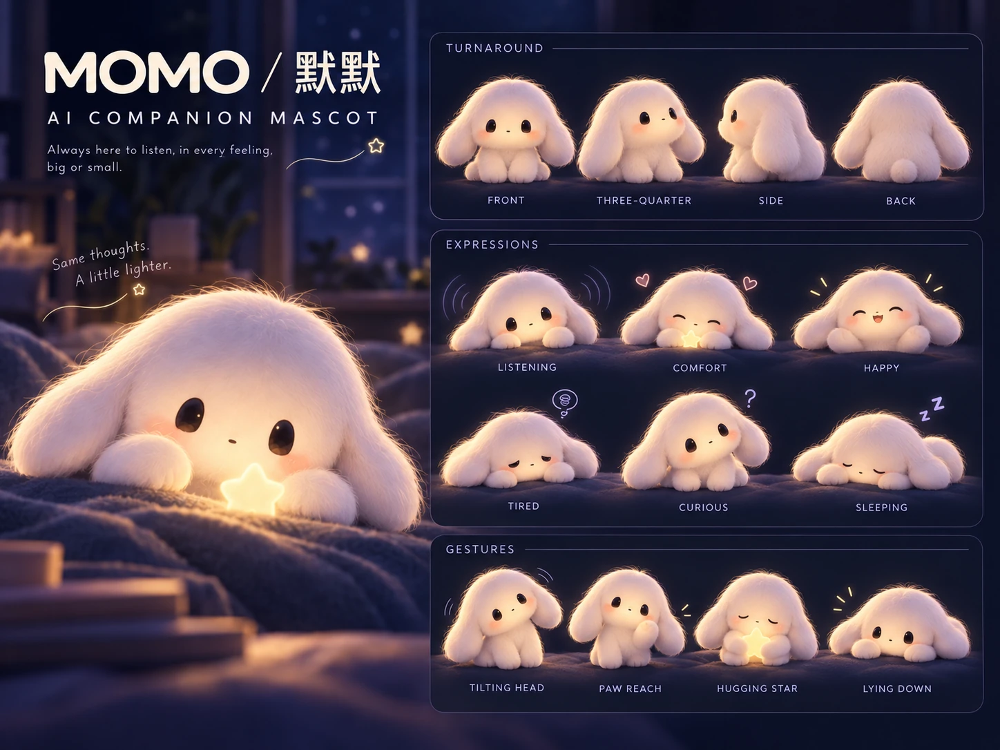
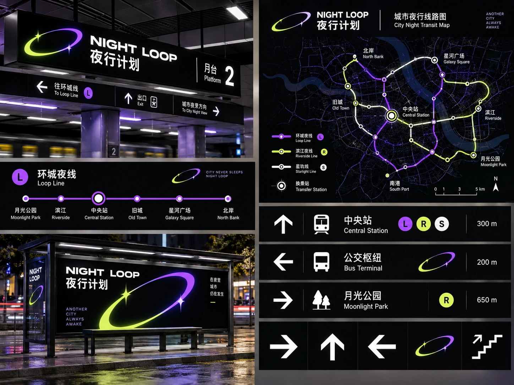
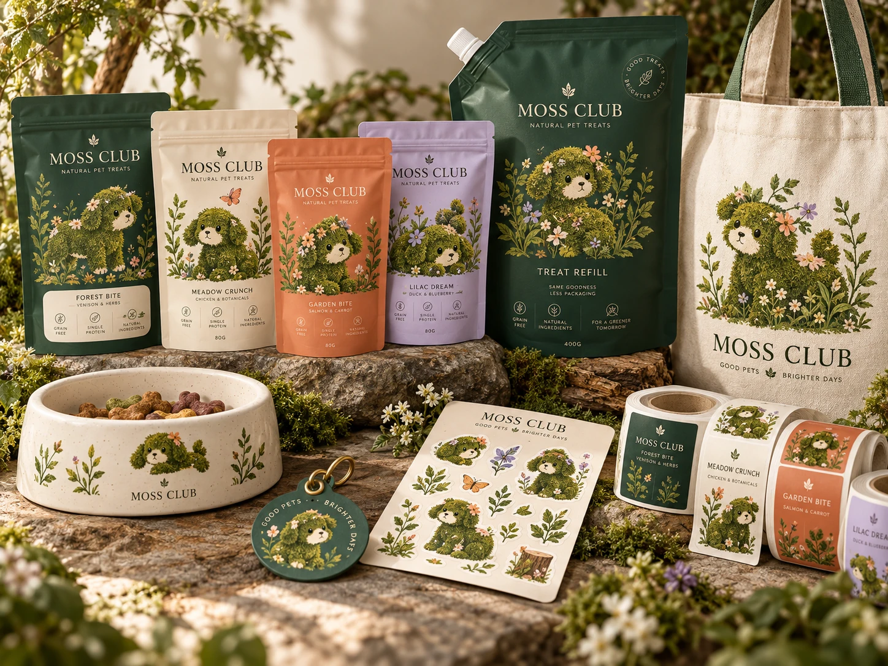
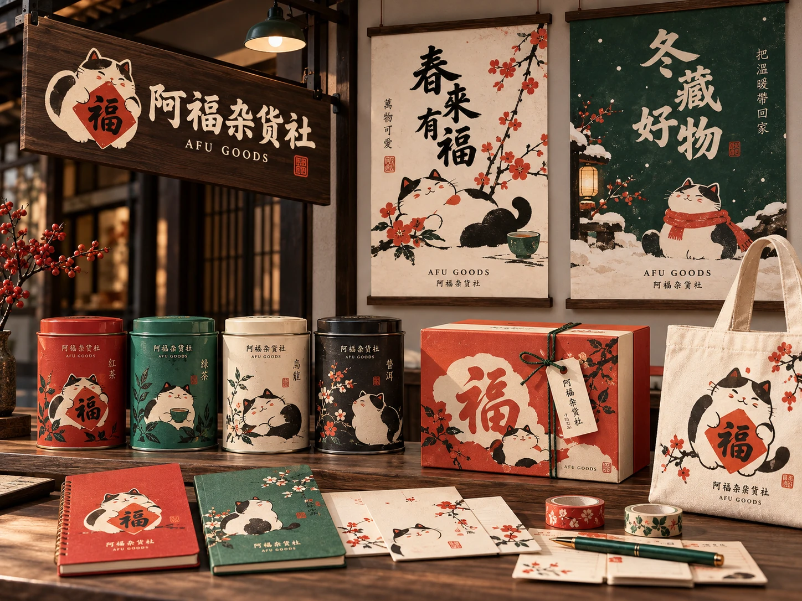

# 2026 视觉作品集 · 四个品牌与体验案例

四个品牌概念，从角色与标志出发，延展到界面、空间、包装与文创。

[MOMO 默默](#momo) · [NIGHT LOOP 夜行计划](#night-loop) · [MOSS CLUB 苔藓俱乐部](#moss-club) · [AFU GOODS 阿福杂货社](#afu-goods)

## 工具与分工

- **个人工作** · 体验策划、美术指导和展示画面的构图安排。各案例列出对应工作。
- **Codex** · 用于本次整理案例、核对图版和发布。
- **原册工具记录** · 工具栏列有 ChatGPT、Codex 与 Midjourney。具体图版的生成工具与 ImageGen 的使用记录待核。

展板、界面和样机呈现设计概念，图中的活动、门店与产品应用为方案示意。

## MOMO

**默默**

### 项目简介

一套把长耳兔角色、情绪选择和对话界面串在一起的 AI 陪伴品牌概念。

### 设计理念

用深蓝夜色、柔光和兔子表情建立陪伴感，让同一个角色出现在标志、对话和周边上。

### 我的工作

- **体验策划** · 编排首次打开、权限设置和情绪选择的引导，再设计文字对话、语音输入和提醒等界面状态。
- **美术指导** · 统一兔形标志、角色比例、表情和配色，并将识别系统延展到社交图与周边。
- **镜头与构图** · 用角色近景呈现陪伴氛围，再通过转面、表情和界面并排展示，说明角色在不同情境中的变化。

### 成果展示

5 张图版，涵盖标志系统、IP 角色、首次引导、对话体验及社交与周边。

[标志系统](images/momo-logo-rabbit.webp) · [IP 角色](images/momo-ip-v2.webp) · [首次引导](images/momo-onboarding.webp) · [对话体验](images/momo-chat.webp) · [社交与周边](images/momo-social.webp)

## NIGHT LOOP

**夜行计划**

### 项目简介

一套围绕城市夜游路线、活动和站点导视的公共品牌概念。

### 设计理念

用轨道环、星点和路线色，将站牌、活动海报与地图界面连成同一套夜游识别。

### 我的工作

- **体验策划** · 以选路线、看活动和找站点为主线，安排路线编码、城市地图、站牌与小程序概念。
- **美术指导** · 确定电光紫、荧光黄绿、轨道环和箭头的视觉方向，并延展到活动海报与站点。
- **镜头与构图** · 用城市远景交代夜游氛围，用站牌与屏幕近景展示信息层级。动态分镜由轨道成形推进到线路展开、站点亮起和城市全景。

### 成果展示

5 张图版，涵盖品牌识别、导视、活动海报、小程序和六格动态分镜。

[品牌识别](images/night-loop-identity.webp) · [路线与导视](images/night-loop-wayfinding.webp) · [活动海报](images/night-loop-posters.webp) · [小程序概念](images/night-loop-app.webp) · [动态分镜](images/night-loop-motion.webp)

## MOSS CLUB

**苔藓俱乐部**

### 项目简介

一个将宠物用品、补充装和社区体验结合的宠物生活方式品牌概念。

### 设计理念

以苔藓角色、植物纹样和柔和的泥土色，统一补充装包装、散步地图和社区活动的视觉。

### 我的工作

- **体验策划** · 围绕选购宠物用品、寻找补充装站点、散步和社区分享，安排包装与 App 的体验触点。
- **美术指导** · 确定植物纹样、苔藓角色和配色系统，并将它们应用到包装、陶碗、贴纸与帆布袋。
- **镜头与构图** · 用整组产品陈列展示包装之间的关系，再通过材质近景和界面组图说明线下用品与线上触点。

### 成果展示

4 张图版，涵盖品牌识别、产品样机、社区 App 和活动传播。

[品牌识别](images/moss-identity.webp) · [产品与包装](images/moss-products.webp) · [社区 App](images/moss-app.webp) · [活动传播](images/moss-social.webp)

## AFU GOODS

**阿福杂货社**

### 项目简介

一个以福印和猫角色为核心，延展至门店、节令礼赠和线上商店的当代中式杂货品牌概念。

### 设计理念

将福印、猫角色、灯笼和园林纹样放进同一套视觉系统，用季节配色区分不同主题。

### 我的工作

- **体验策划** · 串起门店浏览、节令选购、查看商品和送礼的体验，安排线下陈列与线上商店界面。
- **美术指导** · 确定红、绿、墨黑与米白的配色，以及福印、猫角色和纹样在包装、文具与海报上的应用。
- **镜头与构图** · 用门店与桌面陈列建立场景，再用茶罐、礼盒和文具近景展示材质与细节，并排呈现节令海报。

### 成果展示

5 张图版，涵盖品牌识别、零售、线上商店、节令海报和文创样机。

[品牌识别](images/afu-identity.webp) · [门店与包装](images/afu-retail.webp) · [线上商店](images/afu-shop.webp) · [节令海报](images/afu-seasonal.webp) · [文创周边](images/afu-merch.webp)
