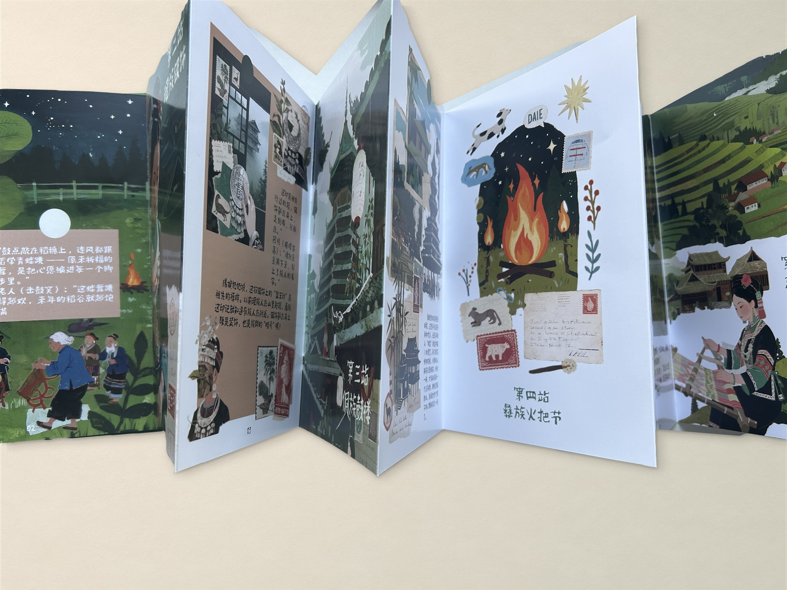
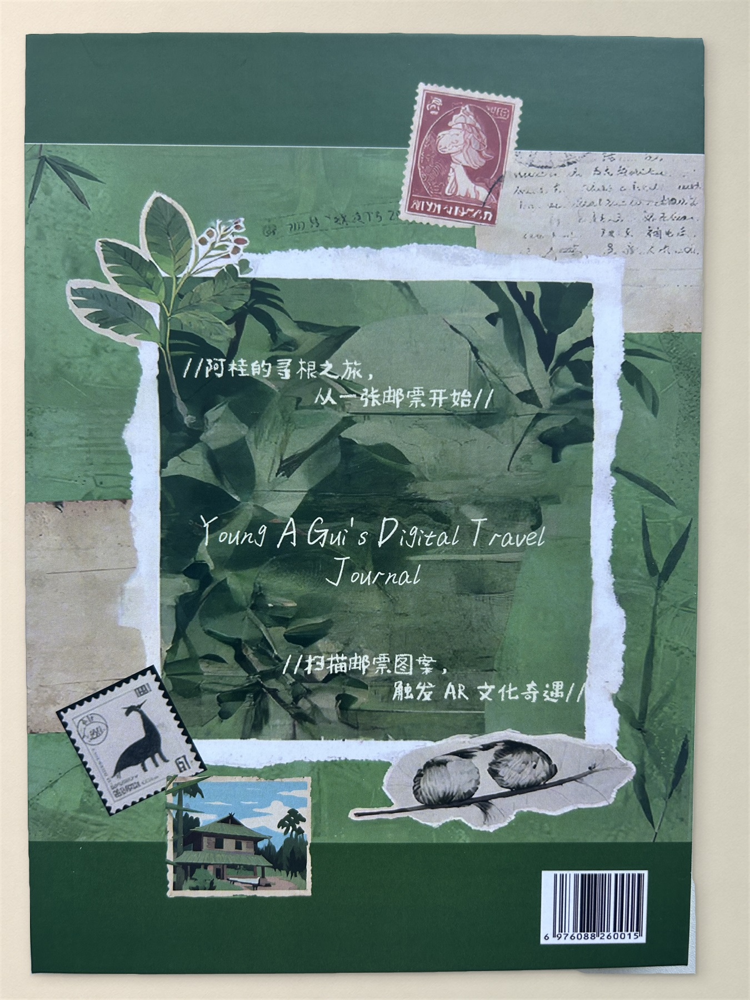
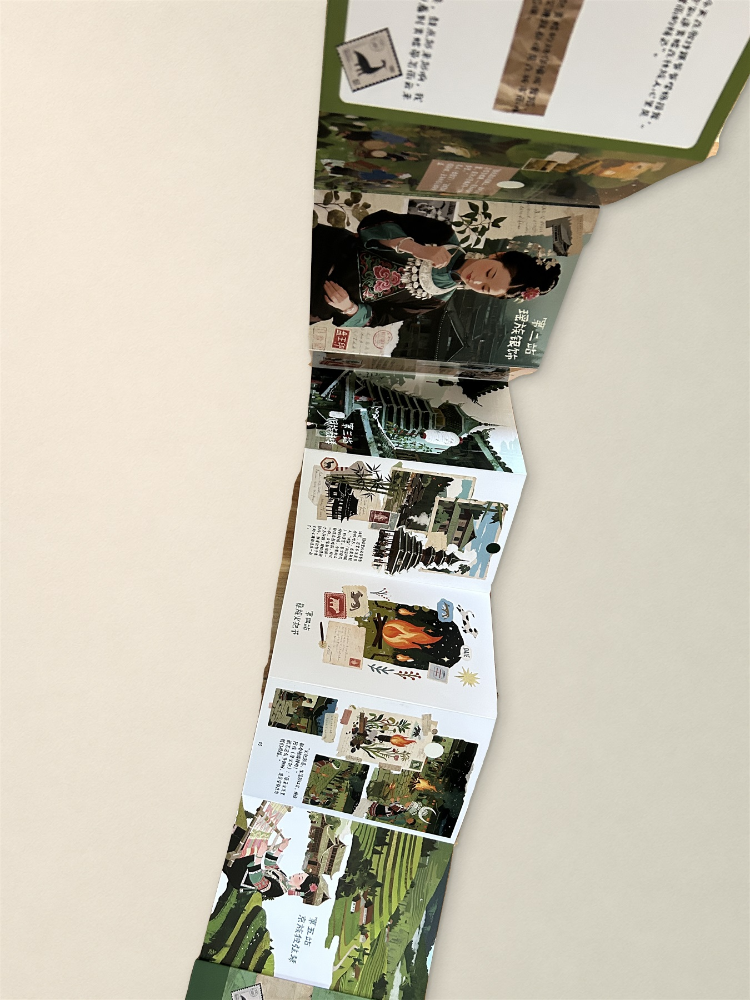
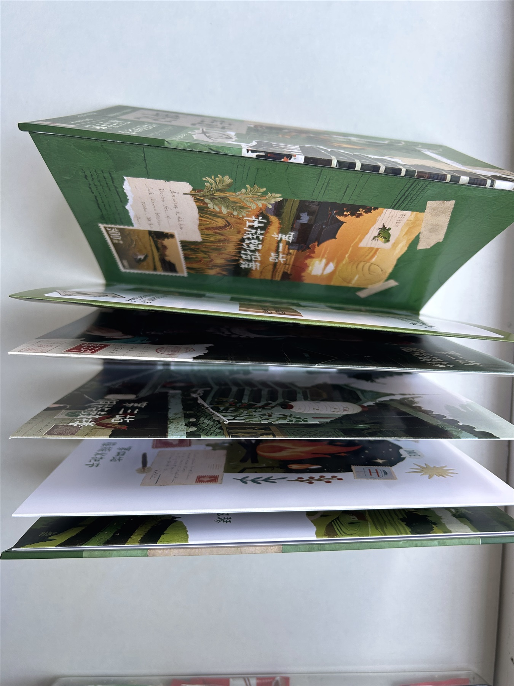
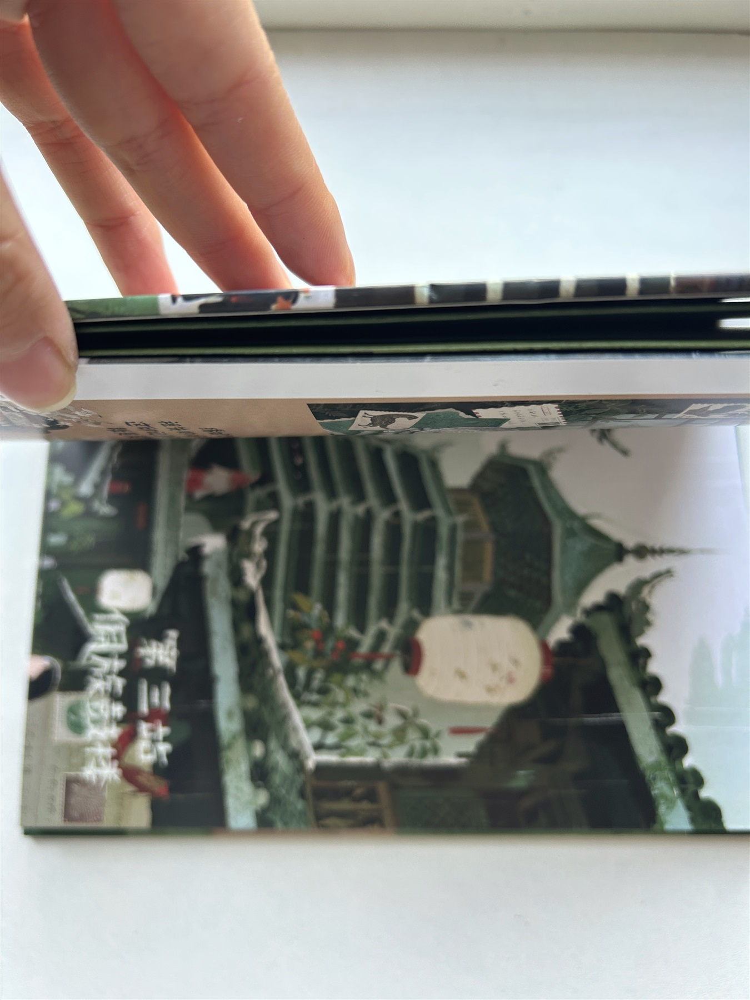
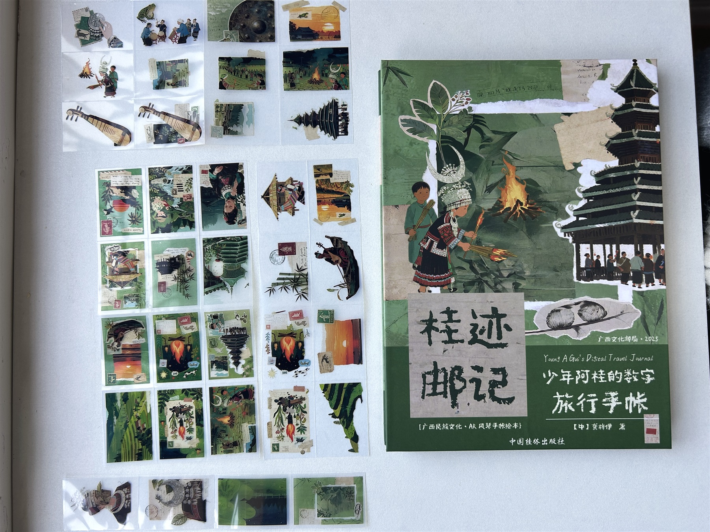
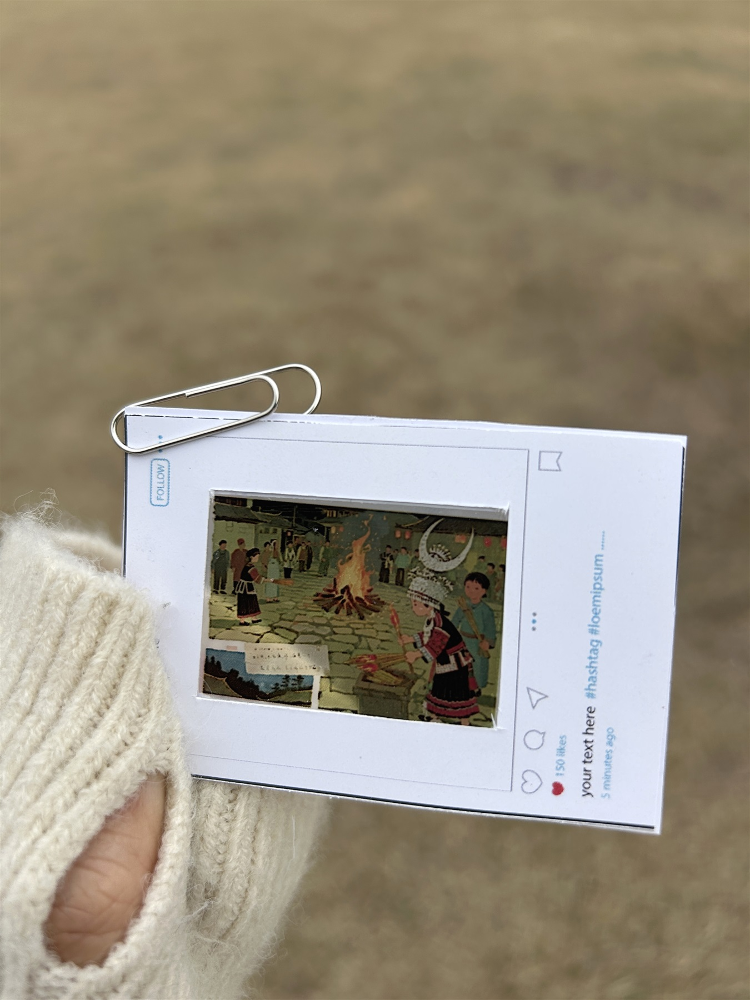
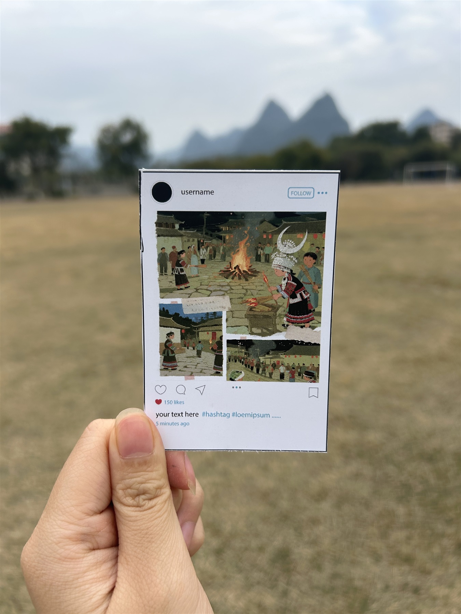
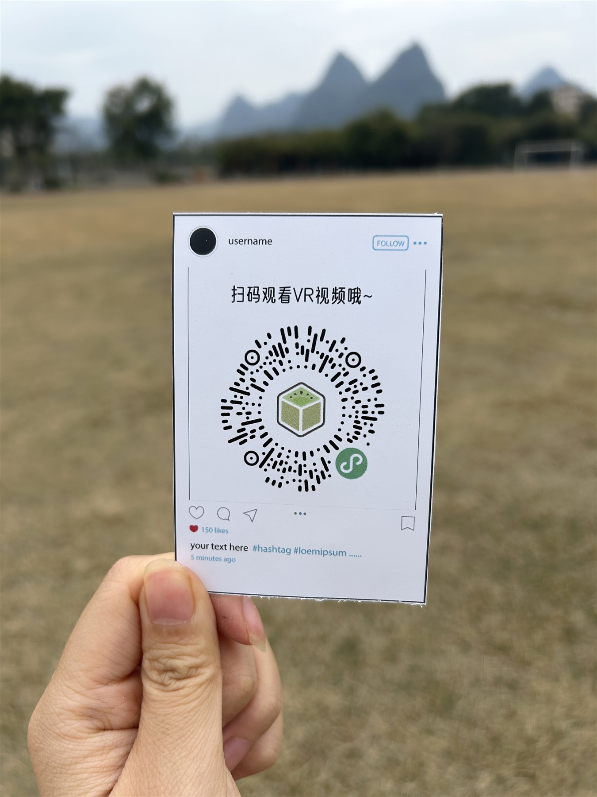

# 桂迹邮记

《少年阿桂的数字旅行手帐》是一本以广西民族文化为主题的风琴折页绘本。故事从南宁出发，用旅行路线串起沿途的建筑、服饰和节庆。

**龚梓伊 著**

[在线打开完整绘本 PDF（16 页）](picture-book.pdf)

## 设计理念

用旅行手帐串联各站，以邮票、印章、手写字和拼贴插画记录沿途见闻。翻阅时可以逐页看，完全展开后则能连续浏览整条路线。配套卡片保留了扫码入口。

## 成果展示

### 封面与封底

| 封面 | 封底 |
| --- | --- |
|  |  |

### 折页与装帧

| 内页细节 | 连续展开 |
| --- | --- |
|  |  |

| 折页侧面 | 装帧厚度 |
| --- | --- |
|  |  |

### 卡片实拍

| 卡片细节 | 卡片正面 | 扫码面 |
| --- | --- | --- |
|  |  |  |

实拍图由 Codex 修整，部分棚拍背景由 ImageGen 生成。

[返回插画与出版](../)
