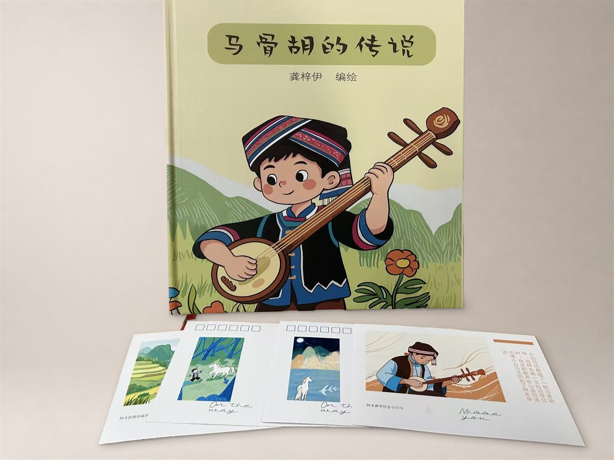
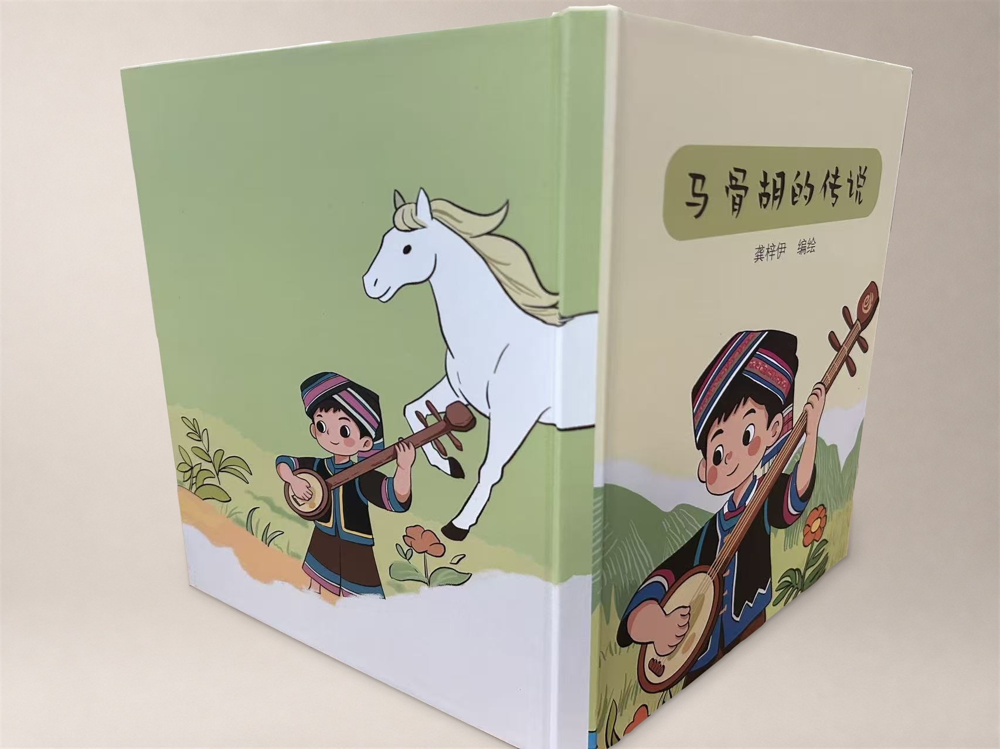
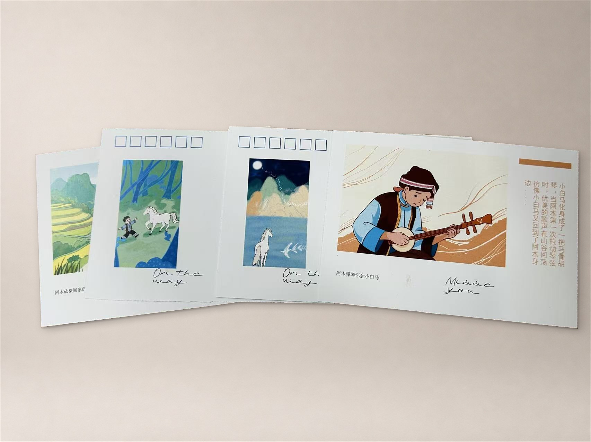

# 《马骨胡的传说》

以广西壮族民间传说为题材的绘本，讲述少年阿木与小白马的故事，以及马骨胡的由来。

## 我的工作

龚梓伊编绘，作品涵盖角色设定、内页插画、绘本装帧和系列明信片设计。作品集照片由 Codex 整理与合成，ImageGen 用于生成浅暖灰棚拍背景。

## 设计理念

用梯田和群山交代故事发生的地方，以壮族服饰塑造阿木的形象。把阿木砍柴、与白马相遇、月下白马和阿木拉琴四个画面延伸成明信片，让读者从不同片段回看故事。

## 成果展示

### 绘本装帧

### 系列明信片

[返回插画与出版](../)
