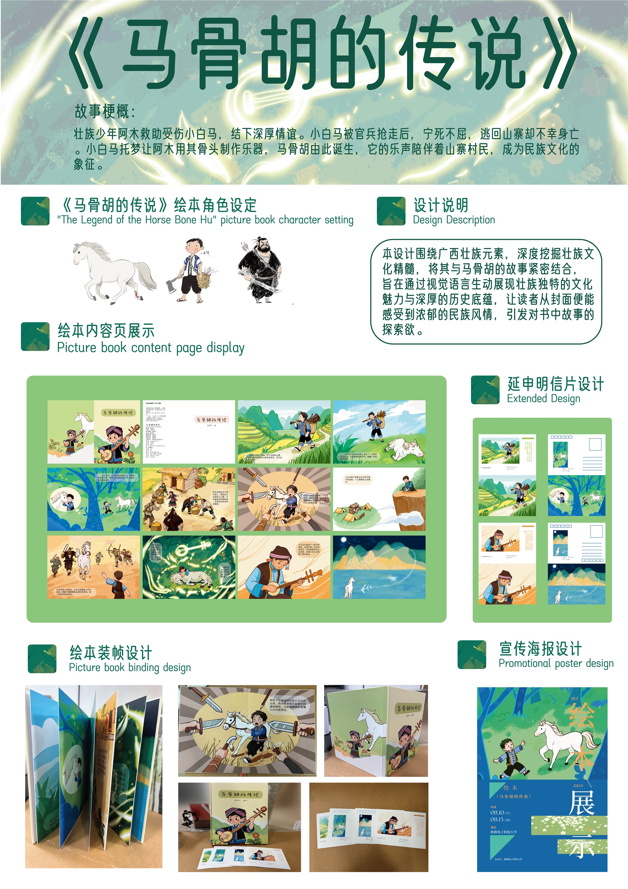

# 《马骨胡的传说》

以广西壮族民间传说为题材的绘本，讲述少年阿木与小白马的故事，以及马骨胡的由来。

## 我的工作

龚梓伊编绘，作品涵盖角色设定、内页插画、绘本装帧和系列明信片设计。作品集照片由 Codex 整理与合成，ImageGen 用于生成浅暖灰棚拍背景。

## 设计理念

用梯田和群山交代故事发生的地方，以壮族服饰塑造阿木的形象。把阿木砍柴、与白马相遇、月下白马和阿木拉琴四个画面延伸成明信片，让读者从不同片段回看故事。

## 成果展示

### 电子书与完整绘本

<video controls playsinline preload="metadata" poster="book/pages/page-01.jpg" width="850" style="display:block;max-width:100%;height:auto" aria-label="播放《马骨胡的传说》电子书">
  <source src="media/ebook.mp4" type="video/mp4" />
  <a href="media/ebook.mp4">打开电子书视频</a>
</video>

[打开视频](media/ebook.mp4) · [下载原始 MP4](https://github.com/Zephyraaaaa/portfolio/releases/download/horse-bone-hu-media/ebook-original.mp4)

[在线翻阅完整绘本（16 页）](book/) · [下载原始 PDF](https://github.com/Zephyraaaaa/portfolio/releases/download/horse-bone-hu-media/picture-book-original.pdf)

### 绘本装帧

### 系列明信片

点击图稿可打开原始 PNG。

| 正面 | 背面 |
| --- | --- |
|  |  |
|  |  |
|  |  |
|  |  |

### 海报与展板

| 绘本展览海报 | 绘本项目展板 |
| --- | --- |
|  |  |
| [打开海报原图](originals/%E7%BB%98%E6%9C%AC%E6%B5%B7%E6%8A%A5%20%281%29.png) | [下载展板原图](https://github.com/Zephyraaaaa/portfolio/releases/download/horse-bone-hu-media/exhibition-board-original.png) |

### 原始实拍

[封面与明信片](originals/67f97326dd38b2de5f2417a7748cf568.jpg) · [明信片俯拍](originals/3cc9ca7bd75813107c021724852776c6.jpg) · [绘本装帧](originals/483687557ac234fb769e8bad9f384338.jpg)

[返回插画与出版](../)
